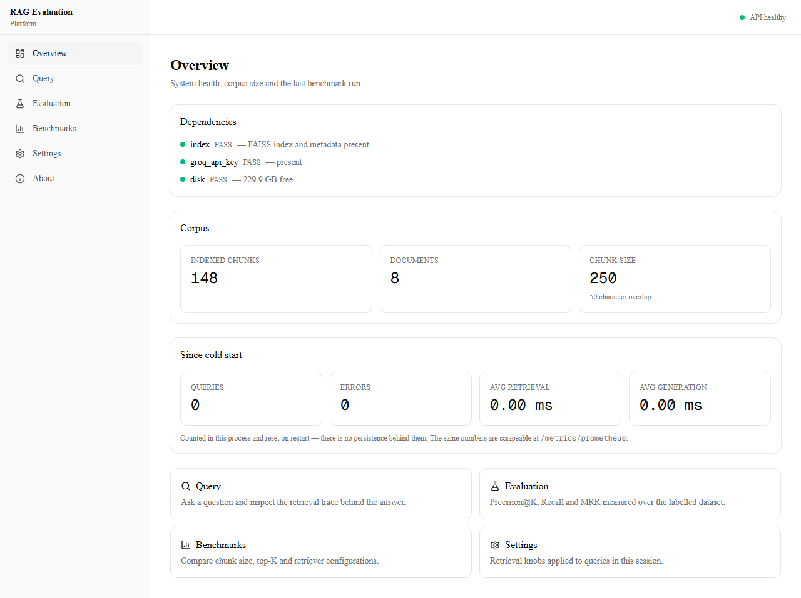
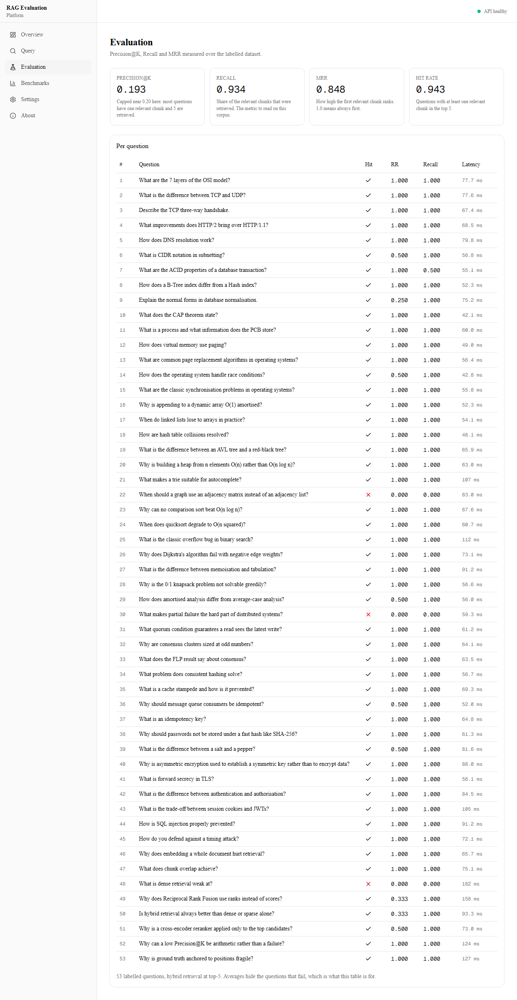
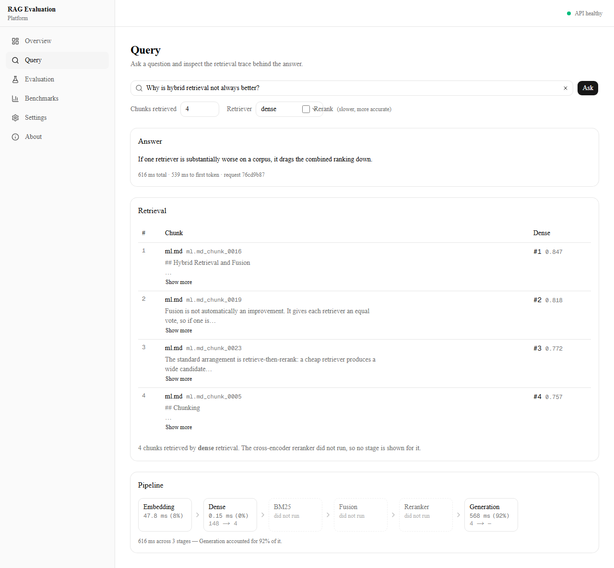
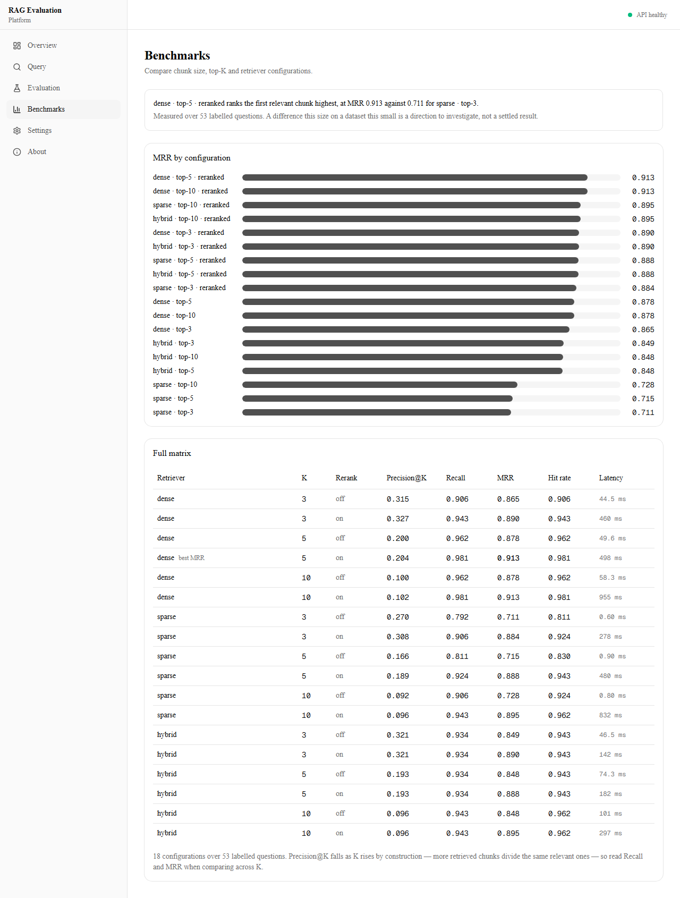

# RAG Evaluation Platform

A retrieval-augmented generation system built from first principles in Python (no
LangChain, no framework abstractions), with a dashboard that shows **why** each
answer was retrieved and **how good** the retrieval actually is.

- **Hybrid retrieval:** FAISS dense search and BM25 sparse search, fused with
  Reciprocal Rank Fusion (k=60).
- **Late-interaction reranking:** ColBERTv2 via RAGatouille, with a cross-encoder
  as a selectable fallback.
- **Measured, not claimed:** every quality and latency number below comes from a
  reproducible benchmark over 53 labelled questions.
- **Deployed:** FastAPI on AWS EC2 (Docker + Caddy, HTTPS), Next.js dashboard on Vercel.



---

## Live demo

| | |
|---|---|
| **App** | `<VERCEL_URL>` |
| **API** | <https://ragevo.duckdns.org> |
| Interactive API docs | [`/docs`](https://ragevo.duckdns.org/docs) |
| Health | [`/health`](https://ragevo.duckdns.org/health) · [`/health/deep`](https://ragevo.duckdns.org/health/deep) |
| Running configuration | [`/config`](https://ragevo.duckdns.org/config) |
| Retrieval quality, measured on request | [`/evaluation?top_k=5&retriever=dense`](https://ragevo.duckdns.org/evaluation?top_k=5&retriever=dense) |

---

## Results

Measured over **53 labelled questions**, top-5 returned from 20 first-stage
candidates (dense first stage, 4-core CPU, no GPU). Full table:
[docs/reranker_comparison.md](docs/reranker_comparison.md).

| Reranker | MRR | Recall@5 | Hit rate | Rerank p50 | Rerank p95 |
|---|---|---|---|---|---|
| none (dense only) | 0.878 | 0.962 | 0.962 | — | — |
| cross-encoder (MiniLM-L-6) | 0.914 | 0.981 | 0.981 | 206.7 ms | 350.6 ms |
| **ColBERTv2** | **0.916** | 0.972 | **0.981** | **66.5 ms** | **68.3 ms** |

- **3.1× faster reranking** at the median (207 ms → 67 ms) and 5× at p95, with
  the same quality as the cross-encoder (MRR 0.916 vs 0.914).
- **MRR +4.3%** over first-stage dense retrieval (0.878 → 0.916).
- **Recall@5 0.972, hit rate 0.981** with ColBERT reranking.

Regenerate with `python scripts/compare_rerankers.py`. It also runs in CI as the
reranker benchmark workflow.

---

## Architecture

```
            Next.js dashboard (Vercel)
   Workspace: upload, index, ask  │  Evaluation Lab: metrics, failures, benchmarks
                                  │  HTTPS (REST + Server-Sent Events)
                                  ▼
                    Caddy (TLS) ──► FastAPI   ─── AWS EC2, Docker Compose
                                  │
           ┌──────────────────────┴───────────────────────┐
           │                                              │
   Indexing worker                                  RAGService
   parse → chunk → embed → index                        │
   (background thread, or Redis)                        ▼
                                          ┌──────────────────────────┐
                                          │ Dense: bge-small + FAISS │
                                          │ Sparse: BM25             │
                                          └────────────┬─────────────┘
                                                       │ Reciprocal Rank Fusion (k=60)
                                                       ▼
                                          ColBERTv2 rerank (cross-encoder fallback)
                                                       │
                                                       ▼
                                          Prompt builder → Groq LLM
                                                       │
                                                       ▼
                                          Answer + sources + per-stage trace
```

### How a query flows

1. **Retrieve.** The question is embedded with `BAAI/bge-small-en-v1.5` and
   searched in a FAISS `IndexFlatIP` (exact cosine). BM25 runs over the same
   chunks to catch exact-term matches that embeddings miss.
2. **Fuse.** Reciprocal Rank Fusion merges the two ranked lists by rank, not by
   score, so the two scoring scales never need calibrating against each other.
3. **Rerank.** ColBERTv2 scores the candidates with token-level MaxSim. Passage
   token embeddings are computed once and cached, so a query only encodes the
   question. If ColBERT fails to load, the service falls back to the cross-encoder.
4. **Generate.** The top chunks go into a prompt for a Groq-hosted model, streamed
   back over Server-Sent Events.
5. **Trace.** Every response carries each chunk's rank and score at each stage
   (dense, sparse, fused, reranked), which the dashboard renders.

Dense, sparse and hybrid retrieval are selectable per request, and reranking is
opt-in per request, so the dashboard can compare them on the same data.

---

## Engineering highlights

These are the problems worth talking about, each with the fix in the code.

- **Caching made ColBERT pay off.** The first version used RAGatouille's
  index-free `rerank()`, which re-encodes every candidate per query. It had the
  same quality but was about 6× *slower* than the cross-encoder (1467 ms vs
  241 ms p50). Caching passage embeddings by text turned that into the 3.1×
  speed-up above. See [ADR 009](docs/decisions/009-colbert-reranker.md).
- **Labels that survive re-chunking.** Ground truth is anchored to answer *text*,
  not to chunk IDs. Positional IDs silently re-point at different chunks when
  chunk size changes; here each label must resolve to exactly one chunk at
  evaluation time, or the run fails.
- **A crash caused by concurrent model loads.** Loading the embedder and a
  reranker in parallel threads left the process unable to load any model
  ("Cannot copy out of meta tensor"). Every model load now goes through one
  process-wide lock (`config/model_loading.py`).
- **Asynchronous ingestion.** `POST /documents` returns `202` with a job id; a
  worker moves the document through parsing, chunking, embedding and indexing
  while the client polls its status. Each corpus has its own index, so uploads
  never touch the benchmark corpus.
- **Production basics.** HTTPS through Caddy with automatic Let's Encrypt
  certificates, a CORS allow-list, per-client rate limiting, `/health/deep`
  dependency checks and a Prometheus endpoint.

---

## Tech stack

| Layer | Choice |
|---|---|
| Embeddings | `BAAI/bge-small-en-v1.5` (384-dim) |
| Vector search | FAISS `IndexFlatIP` |
| Sparse search | BM25 (`rank-bm25`) |
| Fusion | Reciprocal Rank Fusion, k=60 |
| Reranking | ColBERTv2 (`colbert-ir/colbertv2.0`) via RAGatouille; `cross-encoder/ms-marco-MiniLM-L-6-v2` fallback |
| Generation | Groq API |
| Backend | FastAPI, Pydantic, SSE streaming |
| Frontend | Next.js, React, TanStack Query, types generated from OpenAPI |
| Deployment | AWS EC2 (x86), Docker Compose, Caddy, DuckDNS; frontend on Vercel |
| CI | GitHub Actions: lint, frontend checks, Python tests, reranker benchmark |

---

## Dashboard

| Evaluation Lab | Query with retrieval trace |
|---|---|
|  |  |



---

## API

| Method | Endpoint | Purpose |
|---|---|---|
| POST | `/query` | Answer a question, with sources and latency per stage |
| POST | `/stream` | The same, streamed over Server-Sent Events |
| POST | `/documents` | Upload a `.pdf`, `.txt` or `.md` file for async indexing |
| GET | `/documents/{id}/status` | Indexing progress |
| DELETE | `/documents/{id}` | Remove a document and rebuild its index without re-embedding |
| GET | `/corpora` | List corpora |
| GET | `/evaluation` | Precision@K, Recall@K, MRR and hit rate on the labelled set |
| GET | `/benchmarks` | Sweep retrievers, top-K and reranking |
| GET | `/config` | The models and settings that are running |
| GET | `/health`, `/health/deep` | Liveness and dependency checks |

```bash
curl -X POST https://ragevo.duckdns.org/query \
  -H "Content-Type: application/json" \
  -d '{"question": "What are common page replacement algorithms?", "top_k": 5, "retriever": "hybrid", "reranker": true}'
```

---

## Run it locally

Requires Python 3.11 or 3.12, Node 22, and a free
[Groq API key](https://console.groq.com/keys) for generation (retrieval works without one).

```bash
git clone https://github.com/samarthgour2005/RAG_evees.git
cd RAG_evees
pip install -r requirements.txt

# Build the benchmark index
python scripts/build_embeddings.py
python scripts/build_index.py

# API on :8000
export GROQ_API_KEY=gsk_...
uvicorn api.app:app --port 8000

# Dashboard on :3000 (second terminal)
cd frontend && npm install && npm run dev
```

### With Docker

```bash
cp .env.example .env    # set GROQ_API_KEY, ALLOWED_ORIGINS, API_DOMAIN
docker compose up -d --build
```

This starts the API and Caddy, which obtains an HTTPS certificate for
`API_DOMAIN`. Deployment details are in [docs/deployment.md](docs/deployment.md).

### Evaluate

```bash
python scripts/evaluate.py             # retrieval metrics on the labelled set
python scripts/compare_rerankers.py    # ColBERT vs cross-encoder vs none
pytest                                 # test suite
```

---

## Project structure

```
api/          FastAPI app, routers, schemas, rate limiting
retrieval/    FAISS, BM25, RRF fusion, ColBERT and cross-encoder rerankers
embeddings/   bge-small embedder and vector storage
chunking/     Heading-aware recursive splitter (250 chars, 50 overlap)
ingestion/    PDF and text parsers
generation/   Prompt builder and Groq generator
services/     RAGService: retrieve, rerank, generate, stream
documents/    Document records (SQLite) and upload storage
jobs/         Indexing queue (in-process or Redis) and worker
corpora/      Per-corpus index layout
evaluation/   Metrics, labelled dataset, benchmark and reranker comparison
scripts/      CLI for ingestion, evaluation and benchmarks
frontend/     Next.js dashboard
docs/         Architecture, deployment, benchmark reports, ADRs
```

---

## Design decisions

Each major choice is written up as an Architecture Decision Record in
[docs/decisions](docs/decisions): parser, chunking, embedding model, vector index,
provider abstractions, evaluation method, deployment target, frontend
architecture, and the [ColBERT reranker](docs/decisions/009-colbert-reranker.md).

---

## Limitations

- **Small labelled set.** 53 questions, so MRR differences of a few hundredths
  (such as ColBERT 0.916 vs cross-encoder 0.914) are within the noise of one
  question changing rank. The point of the comparison is equal quality at a third
  of the latency.
- **Precision@K is capped** near 1/K, because most questions have one or two
  relevant chunks. Recall and MRR are the metrics to read.
- **Latency depends on the machine.** The numbers above are from a 4-core CI
  runner; re-run the benchmark on the deployment host before quoting its latency.
- **Single-tenant.** There is no authentication, so every corpus is visible to
  every caller.
